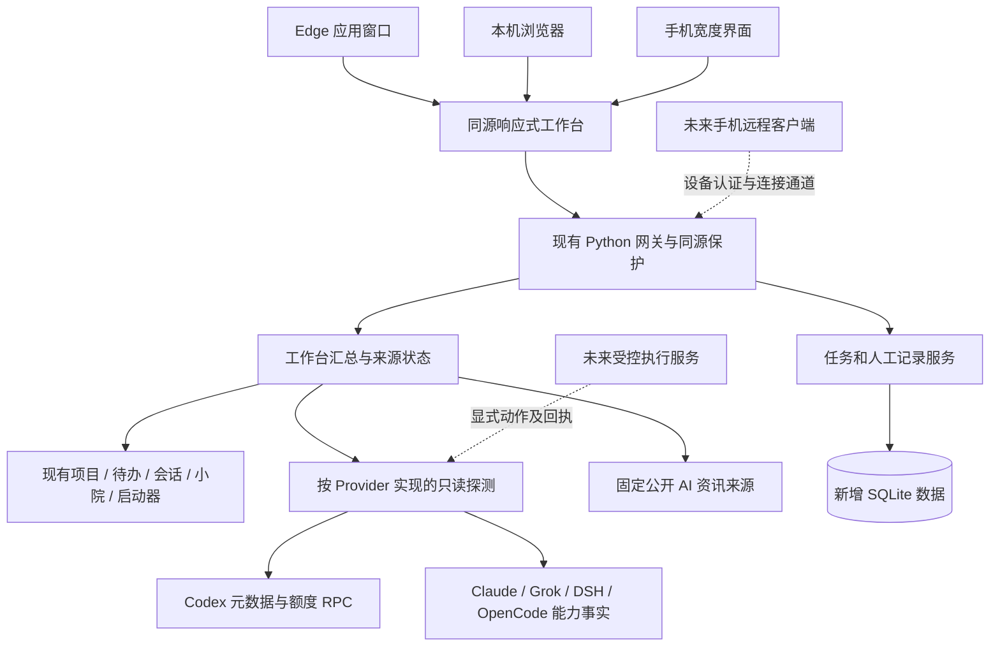

# 多 Agent 工作台架构方案

日期：2026-10-13（Asia/Shanghai）  
角色：hlplan；受众：人类与下游实施者。  
状态：架构决策已用于本轮 M0–M2 实施；实现、验证与未完成项以 `impl_report_r1.md` 为准。M3–M4 为后续路线，不代表已经实现。

实测更新（2026-10-13）：设计阶段 Codex 额度探测曾返回 `-32603`；本轮实现后通过官方 app-server 读取成功，18:08 采样为七天窗口已用 42%、剩余 58%。下面保留设计时事实和失败处理要求；不得把历史探测失败解释成当前必然不可用，也不得把当前一次成功解释成永久可用。

采用**本机 Python 服务 + 同源响应式 Web 工作台 + 按能力区分的 Agent 接入**。保留现有项目、会话观察、小院与固定启动器，把分散的入口汇总为一个可信的管理面。本轮新增任务跟踪、Provider 能力视图、额度来源与 AI 资讯；后续再按真实协议接入执行生命周期。桌面先提供 Edge 应用窗口入口；同一页面适配手机宽度，远程手机连接另行建设。

## 1. 输入与目标

权威约束是 [clarifications.md](clarifications.md) 的完整实现基线；代码事实来自 [research.md](research.md)，外部事实来自 [research-industry.md](research-industry.md)，公开资讯源来自 [research-feeds.md](research-feeds.md)。用户写的 `ocra` 最初按最匹配候选 [stablyai/orca](https://github.com/stablyai/orca) 研究，2026-10-13已获用户明确确认并要求按它推进。`dsh` 仍按 DeepSeek Harness 研究，未另获名称确认。

| 用户目标 | 架构响应 | 本轮验收归属 |
|---|---|---|
| 同时使用 Grok、Codex、Claude Code 等工具 | Provider 能力矩阵、真实发现/观察状态、已有会话与服务入口 | G2：不能把“已安装”展示成“能够派发任务” |
| 管理多个项目、待办和开发进度 | 项目注册和原有进度作为现有事实；新增任务关联项目、Provider 与可选会话 | G2：可新增、筛选、分配 Provider、变更手工状态，并保留既有数据 |
| 每日开发消耗、Codex/Grok 额度 | 订阅额度、日用量和费用分开；展示采样来源与失败；提供明确人工记录 | G2：未知不为 0，人工记录不冒充自动采集 |
| AI 前沿资讯 | 固定公开来源的 AI 资讯列表，保留来源、原文、发布时间和抓取状态 | G2：真实抓取；失败/旧缓存可见 |
| 桌面 App、浏览器与手机可看 | 共享 Web 界面；桌面应用窗口；手机响应式；远程认证单独里程碑 | G3：桌面与 360/390px 真实截图和交互证据 |
| 借鉴开源、优化架构并实施 | 采用 Orca/T3 的能力与主机边界，保留 Python；按增量迁移交付 | G1：选型、备选、迁移、当前与后续边界均可核查 |

本轮不建设完整 IDE、任意命令运行器、云调度平台、自动付费执行或所有 Provider 的通用插件系统。不以迁移全栈替代产品交付，不改写旧 feature 的审查状态。

## 2. 当前基础与问题

目前 `/progress` 已有项目、待办、新闻和启动入口，`/` 已有会话观察和小院。Python 标准库网关、项目 JSON 数据、Codex SQLite 元数据索引、远端 Claude 观察和根线程域小院均可复用。现有网页使用原生 JavaScript/CSS，没有前端构建系统。

需要调整的核心是**数据语义与页面组织**：项目手工百分比、会话身份、进程存活、任务验收、文件修改数目前属于不同来源。把它们拼成“Agent 正在工作/已完成/今日消耗”会产生错误结论。新的汇总层保留来源和覆盖范围，新的任务存储只承载工作台自己拥有的事实。

当前服务固定绑定 loopback，已经具有精确 Host/Origin/CSRF 保护；它没有跨设备身份认证。本轮保持该部署边界。旧项目和待办是 JSON 读改写，不能直接宣称支持多个远程客户端并发编辑；新任务与人工用量使用独立 SQLite 事务。

## 3. 总体架构

图中虚线为后续能力，不随页面卡片出现而变为已实现。手机宽度界面表示同一页面的响应式布局；当前手机尚不能经局域网直接连接 loopback 服务。

### 模块职责

- **工作台汇总**：从现有读取接口组合项目、待办和会话；保留各来源的采样时间、可用性与覆盖范围。某来源失败不应导致全页失败。
- **任务与人工记录**：持有新任务、任务关联和人工额度/日用量记录，使用 SQLite 常规事务；不修改原生 Agent 数据库或已有小院收据。
- **Provider 适配**：实现当前需要的有限探测和读取，返回每项能力与原因。先做明确的 Codex、Claude、Grok、DSH、OpenCode 分支，不增加动态加载或第三方代码执行框架。
- **额度采集**：Codex 通过短生命周期的官方 app-server 只读探测；其他来源按已验证契约接入。所有外部请求须有超时、有限缓存、失败状态和更新时间，避免首页因一个服务失联一直等待。
- **资讯采集**：仅访问经核验的固定公开来源；保存来源状态和最近有效结果。新闻内容作为不可信文本渲染，链接只允许公开 HTTP(S)，不提供任意 URL 抓取入口。
- **Web 管理面**：负责筛选、编辑工作台任务、呈现来源与入口；不得持有 CLI 凭证、读取用户文件或自己决定 Agent 已完成工作。

现有固定启动器与终端定位继续遵守原有合同。“已请求启动”不能显示为“已就绪”。只有真实来源提供就绪证据，界面才展示该结论。

## 4. 四项关键决策

### D1：扩展现有 Python 与原生 Web

| 方案 | 收益 | 成本与限制 |
|---|---|---|
| **现有 Python + 原生 JavaScript/CSS（采用）** | 复用已有数据、保护机制与 202 项基线测试；新增功能可独立验证 | UI 需保持明确模块边界；未来交互复杂到难维护时再评估框架 |
| Python API + React/Vite 重建页面 | 组件化和前端生态更丰富 | 当前没有对应构建链；会增加部署与重写范围，不能直接解决来源真实性 |
| 直接 fork Orca / T3 Code | 自带成熟执行与 IDE 能力 | 丢失本项目现有集成优势；引入整套 Node/Electron、终端与远程基础设施；不是轻量升级 |

依据：当前主要缺口是跨来源汇总、任务数据和准确状态，并非前端框架能力。Orca 本身是完整开发环境，其托管服务还有公开仓库之外的部分，不适合承诺直接搬用。

### D2：任务与关联使用独立 SQLite，保留原有数据

| 方案 | 取舍 |
|---|---|
| **新增 SQLite（采用）** | 任务、人工记录和关联需要一起写入与明确失败；现有 Python 已使用 SQLite，无新增基础设施 |
| 延续全部 JSON | 初期简单，但新任务编辑、状态和关联更容易出现并发覆盖 |
| 一次迁移所有旧数据 / 事件溯源平台 | 可统一存储，却扩大旧功能回归和迁移风险；本轮没有需求支撑 |

新增库不自动吞并项目注册、手工进度、待办或 garden 库。旧来源由汇总层读取，未来需要迁移时另有备份、校验和恢复方案。旧 JSON 并发问题保持显式限制，不因新库存在就宣称消失。

### D3：能力驱动的管理面，执行按协议渐进接入

| 方案 | 取舍 |
|---|---|
| **先建立任务、会话、能力事实，再逐 Provider 接入执行（采用）** | 立即减少入口分散，同时避免假任务和假回执；继承 Orca 能力声明与 T3 主机边界 |
| 模拟键盘，把所有终端统一成控制 API | Windows 就绪和输入兼容成本高；不能可靠提供审批、恢复和取消语义 |
| 强制所有 Provider 使用 ACP | ACP 有真实标准，但并非所有 Provider/版本支持；Codex 官方协议、Claude 专用接口与 DSH SDK仍有价值 |

长期协议策略：Codex 优先官方 app-server；Claude 优先受支持 SDK/协议；Grok、OpenCode 按本机版本验证 ACP；DSH 按匹配版本的 Python SDK 与显式 `DSH_HOME` 接入。各自保留能力差异，不强行做最小公分母式假兼容。

### D4：共享 Web 界面与桌面应用窗口，远程接入独立推进

| 方案 | 取舍 |
|---|---|
| **本轮 Edge 应用窗口 + 浏览器（采用）** | Windows 现有浏览器可用，页面与浏览器完全同源；无新增打包器 | 
| Tauri 原生壳 | 原生分发轻量，但需 Rust/系统工具链、Python sidecar 生命周期与签名更新设计 |
| Electron 原生壳 | Orca/T3 有成熟参照，桌面能力完整，但体积与运行时更重 |

应用窗口不是原生安装包；本轮文档与截图必须如此表述。真正原生壳等桌面进程托管、更新和分发成为明确目标后再选择。手机远程访问需要主机常驻、设备认证、撤销和传输保护，不能通过改为 `0.0.0.0` 就算交付。

## 5. 数据模型与真实性规则

以下是领域概念，不要求本轮为所有未来概念建立空表。

| 概念 | 拥有的事实 | 本轮来源与写入边界 |
|---|---|---|
| Project 项目 | 稳定项目 ID、名称、登记根目录、手工进度、文档线索 | 复用原注册和进度；进度标注“手工”，新汇总区分未记录与真实 0%；文档线索保留证据，不能代替验收 |
| Workspace 工作区 | 项目与主机上的一个实际目录，可进一步是 Git worktree | 本轮等同已登记项目根目录；不创建 worktree，不自动初始化 Git |
| Task 任务 | 标题、项目、负责 Provider、可选会话关联、手工状态、更新时间 | 新 SQLite；状态可为待办/进行中/阻塞/待验收/完成；每次修改注明人工来源 |
| Session 会话 | Provider、本地或远端主机、原生会话 ID、cwd、可读取状态、来源覆盖范围 | 复用可验证的身份元数据；不靠目录名、进程或最近消息推导任务完成 |
| Provider 工具 | 工具类型、发现结果、支持能力、当前可用性与失败原因 | 支持能力与运行时可用性分别存取；工具缺失不删除用户任务 |
| UsageObservation 用量观察 | Provider/产品范围、日期或窗口、指标值及单位、来源、采样时间、状态 | 只读采集或明确人工记录；百分比、Token、金额互不折算 |
| NewsItem 资讯 | 来源、标题、原文 URL、发布时间、抓取时间与相关性标注 | 固定公开来源；无摘要生成、无私人内容外传 |

任务分配 Provider 仅表示计划由该工具负责，**不发送提示词**。关联会话只建立追踪关系，不创建/恢复会话，不接管已运行进程。会话来源过期后保留任务，同时标注关联当前不可验证。若任务项目与会话 cwd 不匹配，应显示差异，不默默改项目归属。

可用性至少区分：有有效数据、空结果、不可用、旧缓存、尚未接入。状态需同时附来源和时间；空结果不是源故障，缺值不是零。前端不能把缺失能力默认为可用。

用量规则：

1. Codex `usedPercent` 是特定窗口的已用百分比，剩余量只在值有效时计算为 `100-usedPercent`；每个 limit bucket 单独显示。
2. 本机 `codex-cli 0.118.0` 支持 `account/rateLimits/read`，没有已证实的 `account/usage/read`。root 实际探测退出码为 0，但业务结果 `unavailable`、错误码 `-32603`；当前不得显示真实额度百分比或暗示登录可用。
3. 额度卡支持重试与原服务入口。人工额度和每日记录须有日期/时间、产品范围与“手工记录”标签，不覆盖自动采集来源；过期信息仍显示记录时间。
4. 日 Token、订阅百分比和费用不能相加为一个总消耗。金额必须保留币种与估算/账单/人工属性；跨 Provider 只有同单位且覆盖一致时才有聚合意义，本轮不提供误导性总费用。
5. Grok 网页订阅池、Grok CLI credits 与 xAI 团队 API 账单分开。没有用户产品与稳定读取契约时显示未接入，而非自动读取 OAuth token 或假定 100% 剩余。
6. 本地日志统计是后续独立来源，需要去重、累计增量、时区和覆盖率验证；不能把多个累计快照相加，也不能称跨设备账户账单。

## 6. Provider 能力矩阵

这是设计目标与已知基础的对照，实际页面必须由运行时证据决定“已发现/可用”。未执行的本机探测均保留未知。

| Provider | 本轮可实现的发现/观察 | 本轮额度/日用量 | 本轮执行控制 | 后续真实协议 |
|---|---|---|---|---|
| Codex | 复用本机身份元数据、cwd 和覆盖范围；活动/完成仍未知 | 官方额度 RPC，当前账号结果不可用；日用量人工或未知 | 未实现 dispatch/cancel/approve；原会话入口独立保留 | app-server 初始化、会话与 turn 生命周期，按版本验证 |
| Claude Code | 复用既有远端观察/终端定位入口；本机 CLI 发现单独标注 | 订阅额度未接入；日成本/Token 无来源时人工或未知 | 旧定位不等于新执行控制 | 受支持 SDK/协议；OTel 采集须显式配置且不追溯虚构历史 |
| Grok | 现有会话目录提示只表示目录线索；CLI 可执行发现另报 | 网页/CLI/API 分开显示；未验证则未接入，可人工记录 | 未实现 | 经版本验证的 `grok agent stdio` ACP；CLI billing 现有开源实现不是官方稳定保证 |
| DSH | 只读发现 `dsh`、`dsh-tui`/`dst` 可用性，不运行登录或会话 | 未接入 | 未实现；Orca 的 DSH 终端支持不等于结构化支持 | 匹配版本的 DeepSeek Harness Python SDK 与显式 home |
| OpenCode | 只读 CLI 发现，历史观察未接入 | 未接入 | 未实现 | 经版本验证的 `opencode acp` 与能力协商 |

对每种工具至少分清：命令/服务发现、历史观察、已有入口、结构化执行、额度读取。可执行文件存在只能证明发现；不得为发现工具而执行会启动 agent、登录或配置变更的命令。新增入口必须是固定、安全且经过核验的动作，不接收任意 shell 内容。

## 7. 页面信息架构

视觉方向是安静、清晰且信息密度较高的中文开发工作台。桌面以侧导航、项目/任务主区和辅助信息区组织；手机以简短导航与单列内容保持主要操作容易到达。颜色用于区分状态，不用动画冒充活动。

| 页面/区域 | 核心内容 | 关键操作与真实性 |
|---|---|---|
| 总览 | 待处理任务、登记项目概况、来源状态、额度摘要、最新 AI 资讯 | “待处理”来自任务状态；不显示虚假的运行 Agent 数量或总费用 |
| 项目与任务 | 按项目筛选的任务列表/看板、进度备注、文档线索、关联会话 | 新增任务、分配 Provider、改手工状态、关联可验证会话；项目原编辑入口保留 |
| Agents | 五种工具的能力表、发现与观察状态、已有会话入口 | 清楚区分未发现、未接入、来源失败；任务指派不称为派发 |
| 用量与额度 | Codex 窗口、Grok 产品范围、每日人工记录和来源说明 | 显式重试、记录手工值、跳转原服务；未知不画满进度条 |
| AI 资讯 | 时间倒序的公开 AI 新闻、来源、发布时间和更新时间 | 打开原文；抓取失败仍保留旧结果及失败提示 |
| 辅助入口 | 今日原有待办、固定启动器、旧会话指挥室/小院 | 继续使用已交付入口，不复制或改写旧收据语义 |

本轮采用新增工作台入口，与 `/progress` 和 `/` 并存；最终固定入口由 LW Plan 确定。旧页面须可从工作台一跳访问。首页避免把所有项目的全部文档和会话无限展开，详情按用户选择显示，手机不需要滚过整套项目卡片才能找到任务或额度。

加载时分别呈现各区域状态。刷新不能覆盖正在编辑的内容；提交失败保留用户输入并提示实际失败。360/390px 不得依赖横向滚动才能完成新增任务、切换状态或查看额度来源。

资讯采用已实测 HTTP 200 的固定来源：[Google AI](https://blog.google/technology/ai/rss/)、[OpenAI News](https://openai.com/news/rss.xml) 和 [Hugging Face Blog](https://huggingface.co/blog/feed.xml)。后者含社区作者，不能把每条都标为官方公告。现有 HN 保留在旧入口，不必为本轮新增另一聚合协议。仅提取标题、HTTPS 原文链接、发布时间和来源，限制响应大小与展示条数；单来源失败不清空其他结果，CDATA 按文本处理。界面标明刷新间隔/采样时间，不承诺实时推送或完整覆盖行业。

## 8. 长期执行生命周期与跨端路线

统一管理的最终形态需要以下闭环，但本轮仅交付其任务与观察基础：

1. 用户选项目、工作区与 Provider，形成明确任务意图。
2. 主机端核验该 Provider 当前能力、工作区范围和账号状态，展示待执行动作。
3. 只有显式提交后，执行服务调用原生协议；保存原生会话/turn 标识和真实接收回执。
4. 收集运行事件，分开表示运行、等待用户、等待工具许可、结束、失败、失联与取消结果。
5. 审批只回答 Provider 已发出的具体权限请求，不开启全局自动审批。
6. 用户取消后显示“已请求取消”，收到协议结果后才显示结束；失联不能自动重发任务。
7. 任务完成依赖产物和验收，模型 turn 结束不等于任务完成；现有小院收据可作为受限来源继续使用。

后续最小执行增量优先只选一个已安装且版本可验证的 Provider，以隔离工作区验证创建/恢复、事件、审批和取消；通过后再扩展下一种 Provider。当前不引入工作流引擎、消息队列或跨服务事件溯源。

远程手机路线借鉴 Orca/T3 的“执行留在主机，客户端按设备授权连接”：先定义设备配对、访问权限、撤销和主机可用性，再确定受认证的私有网络入口或出站中继。是否需要云中继应由实际网络与使用条件决定。本轮不修改监听、防火墙、凭证或全局配置。

## 9. 迁移里程碑与交付范围

| 里程碑 | 内容 | 验收 / 回退 |
|---|---|---|
| M0：基线与方案 | 当前源码快照、事实报告、完整基线、hlplan/LW Plan/独立评审 | 新增范围可追溯；旧文档历史不改写 |
| M1：本轮数据与管理能力 | 新任务事务存储、Provider 事实、项目/待办/会话汇总、Codex 额度结果、人工记录、固定 AI 来源 | fixture 验证状态与失败；root 真实探测核查来源；可停用新增入口，旧数据未迁移 |
| M2：本轮工作台与预览 | 新响应式页面、原入口连接、Edge 应用窗口启动入口 | 真实桌面和 360/390px 交互、截图；原有测试与关键旧页面复核 |
| M3：后续单 Provider 执行闭环 | 原生协议执行、可见审批、取消与回执、产物验收关联 | 隔离验证真实生命周期；不以任务卡片代验收 |
| M4：后续跨设备与分发 | 配对/撤销/认证连接；必要时原生桌面安装包 | 实际手机连通与访问边界验证；布局截图不可替代 |

本轮交付范围为 M0–M2。M3–M4 有架构路线但未实现；最终报告必须显式列出。停止新增功能后保留新增库供恢复，不以删除用户任务作为回退步骤。无 Git 环境使用现有快照与文件差异记录，不虚构 commit/push。

## 10. 风险与未确定事实

| 风险/不确定点 | 影响与处理 |
|---|---|
| U1：名称识别 | Orca已获用户确认；DSH保留候选说明，架构采用通用能力原则，不锁入未证实产品 |
| U2：Codex 官方方法存在但当前读取失败 | -32603 是业务不可用；UI 展示原因、重试和人工来源，不自动登录/升级/启动 turn |
| U3：Grok 套餐/读取契约不确定 | 产品范围分开，提供服务入口和人工记录，不读取 token 仿造订阅接口 |
| U4：五种工具的本机状态及会话范围未全量实测 | 逐项能力探测；覆盖数量和未知清晰呈现，fixture 不作为真实接入证据 |
| U5：旧小院绑定与终端定位依赖当前运行环境 | 保留独立页面与既有合同；本轮不重置、接管或重启原运行服务 |
| U6：AI feed 会持续变化或暂时失效 | 三个固定来源已获本轮 HTTP 200；该快照不保证持续可用，超时、响应上限、失败、过期缓存必须有界且可见 |
| U7：旧 JSON 并发与项目文档缺失 | 新任务使用事务；汇总读取归一化空/失败，必要的窄修复须追溯到本轮显示需求，不顺手迁移旧系统 |
| U8：原生壳、手机远程尚未建设 | 交付准确写“桌面应用窗口、响应式预览”；不宣称原生安装或跨设备连通 |
| U9：来源内容和任务文本不可信 | 文本渲染、链接协议检查、精确字段校验；不把外部文本当操作指令 |

## 11. 下游 LW Plan 拆解要求

LW Plan 需要明确：

1. 新入口和现有接口如何复用；哪些来源失败可独立降级；页面上每个统计数字追溯到哪个真实字段。
2. 新任务及人工记录的最小字段、状态、事务、冲突/失败语义与持久化验证；与旧待办、项目进度的区别。
3. Provider 探测的允许动作、时间上限、能力与可用性返回形状；Codex app-server 初始化和回收过程，不出现推理/登录/额度购买动作。
4. 额度/用量的单位、日期、时区、记录来源、未知/过期规则，以及真实 `-32603` 结果对应的 UI；不要为演示补造成功数字。
5. 经核验的 AI 来源、原文字段、时间排序、缓存与失败处理；不接任意用户 URL。
6. 桌面布局、360/390px 操作路径、键盘/焦点/表单错误状态，真实截图输出位置；截图使用实际页面，不生成概念图冒充交付。
7. Edge 应用窗口入口的边界及服务未启动时的表现；不暗中占用端口或终止旧进程。
8. 当轮全部相关测试、fixture 与真实来源证据、独立 review、失败记录，以及每次修复后的重新验证范围。

验收必须逐条覆盖 G1–G3。root 负责真实运行、公共资讯和官方只读探测；实施者负责本地 fixture、语法和业务验证。任何演示数据必须隔离在测试中，不能写入用户进度/任务并留作真实成果。

## 12. 外部方案采用依据

- **Orca**：采用能力声明、终端与结构化 Agent 区分、主机负责执行和凭证。参考固定提交的 [Agent 注册](https://github.com/stablyai/orca/blob/aceebea0a4453f63d759af9134503220ce0b4753/src/main/native-chat/agent-session-wire/structured-agent-registry.ts)、[ACP 接入](https://github.com/stablyai/orca/blob/aceebea0a4453f63d759af9134503220ce0b4753/src/main/acp/acp-launch-specs.ts)、[TUI 配置](https://github.com/stablyai/orca/blob/aceebea0a4453f63d759af9134503220ce0b4753/src/shared/tui-agent-config.ts)。不直接搬入其完整 IDE 和云服务。
- **T3 Code**：采用 [主机执行与客户端共享协议](https://github.com/pingdotgg/t3code/blob/main/docs/internals/overview.md) 和 [远程设备配对](https://github.com/pingdotgg/t3code/blob/main/docs/user/remote-access.md) 的边界；当前无需复制完整事件溯源与 outbox。
- **Vibe Kanban**：参考 [任务与工作区分离](https://github.com/BloopAI/vibe-kanban/blob/main/README.md)，不作为默认底座；调研时上游 README 已说明 sunsetting，尽管仓库尚未 archived。
- **ACP / DSH**：后续控制参考 [ACP 能力协商与会话协议](https://agentclientprotocol.com/protocol/v1/overview) 和 [DSH Python SDK](https://github.com/deepseek-ai/deepseek-harness/blob/master/python/sdk/README.md)，保持版本验证与 Provider 差异。
- **额度**：遵循 [Codex App Server](https://learn.chatgpt.com/docs/app-server)、[Claude 成本边界](https://code.claude.com/docs/en/costs)、[xAI Management Billing](https://docs.x.ai/developers/rest-api-reference/management/billing) 与 [Grok FAQ](https://docs.x.ai/grok/faq) 的产品范围；本机版本证据优先决定可执行的方法。

以上是设计参考，未复制外部实质代码。若后续复制代码，必须保留对应许可和版权；架构参考本身不要求引入这些项目为运行依赖。

---

## 跨功能事实（待确认）

### 架构与约束

- [2026-10-13] 同一工具的协议支持、当前账号可用性、历史观察和执行权限需要独立表示；一项成功不能推导另一项成功。
- [2026-10-13] 工作台任务状态、Agent 运行结束和产物验收分别属于不同事实源，跨工具管理需要保留这种区别。
- [2026-10-13] 响应式布局、桌面应用窗口、原生安装包和手机远程连通是四种不同的交付能力，须分别验证。
