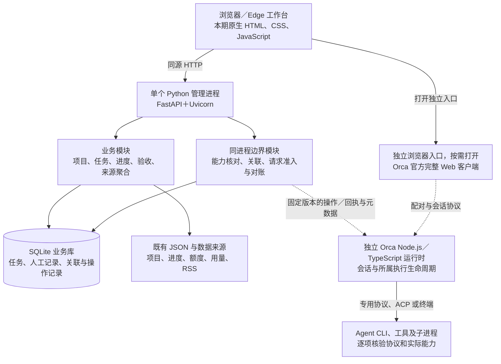

# 个人开发工作台最终技术架构设计

日期：2026-10-14；角色：architecture-design；受众：用户、后续设计与实施者。
状态：架构设计 v1；评审状态见 README 与对应评审记录；未实施、未实测。技术路线选择与运行可用性分别判定，本文件未授予 Readiness、低层计划、Gate-2 或真实模型验收。
本文件收敛当前唯一技术设计入口；原 hlplan 与技术补充保留为历史输入，审查状态由 README 与最终评审记录承载。
需求与授权：[当前基线](clarifications.md)、[原工作台目标](../agent-workbench-20261013/README.md)。事实依据：[运行时研究](research.md)、[稳定性研究](research_stability.md)、[Agent 兼容性研究](research_agent_compatibility.md)。

## 1. 设计结论与交付目标

选择“单机模块化 Python 管理服务＋SQLite＋浏览器界面”，执行能力有条件复用独立 Orca 运行时及完整官方 Web 客户端。
管理面继续承担项目、待办与任务、进度、人工验收、额度／每日用量来源、AI 资讯聚合；Orca 承担经过验证的 Agent 会话能力。
本期保留自有原生 JavaScript 页面，采用 FastAPI／Uvicorn 替换 HTTP 服务外壳，分别推进服务迁移与 Orca 验证。Rust 整体重写不采用。
目标是每项操作可追溯、过载有界、失败可辨认、升级可回退；容量和可用性须由测试证明，不由技术名称保证。

当前实际实现仍为 Python 3.12、ThreadingHTTPServer、SQLite、原生 JS 和 Edge 应用窗口；Orca 未接入。
旧 M3 自研执行尚未真实验收，按原交接保持暂停；本轮只处理架构文档，不安装、启动、接入账号或修改产品。
像素小人嵌入延期，已有小院账本和数据保留；原生安装包、手机跨设备访问、全 Provider 统一控制不属于本期交付。

## 2. 明确采用、条件采用与延期

| 决策 | 本期选择与理由 | 替代路线及重评条件 |
|---|---|---|
| D1 服务与语言：明确采用 | 保留 Python 业务模块；FastAPI＋Uvicorn，单管理进程。成熟请求校验和生命周期替代手写 HTTP 外壳，降低迁移面 | 保留旧 HTTP 仅作迁移退路；整体 TS／Rust 重写成本高，当前无性能证据。局部 Rust 只在实测热点且普通优化不足时重评 |
| D2 自有界面：明确采用 | 本期维持原生 HTML/CSS/JS，按业务模块维护；保持现有交互并按需打开 Orca 页面，不同时重写前后端 | React＋TypeScript 有维护收益但不是性能保证；新增复杂共享状态页面出现后另作增量选型，本期不建立双套自有框架 |
| D3 存储：明确采用 | SQLite 保存业务事实和来源关联，短事务、版本迁移、一致性备份与还原；保留现有 JSON 各自所有权 | PostgreSQL 待持续写锁瓶颈或多主机写需求被证明后重评；不为预期规模引入服务数据库、Redis 或消息中间件 |
| D4 执行与展示：条件采用 | 固定版本外置 Orca Node/TS＋官方 React/TS/Vite 完整 Web，先独立浏览器入口；复用上游现成生命周期与界面 | 抽模块、iframe、组件复制、整库 fork 均延期；隔离、维护成本或控制验收不成立时维持现状，具备安全入口条件时可仅提供入口 |

浏览器是本期交付载体；Edge 应用窗口沿用为桌面入口。Tauri／Electron 自有壳待安装、更新或系统集成需求明确后再选。
先稳定单机服务边界，未来手机通过受认证的 API 访问；跨设备监听、认证和网络部署须另行设计，不能直接开放当前 loopback 服务。

## 3. 技术与进程边界

下图是目标设计，虚线表示 Orca 条件采用接口，尚未实机验证。

业务和边界模块均在一个管理进程内，不部署为微服务。Orca 独立运行，浏览器刷新／关闭不应隐含取消任务；这一生命周期目标仍需验证。
管理服务只发有界请求，不占用 HTTP 请求等待整个模型任务；现有阻塞 DB／文件／来源调用放入有界工作位置，不能只加 async 声明。
管理 API 继续仅监听本机，继承等价 Host／Origin、客户端访问规则、敏感操作 CSRF 和 Windows 独占监听合同；框架迁移不得弱化这些保护。
管理页与 Orca 客户端各守自身权限边界，不因连通需求默认放宽 CORS 或转发凭证；配对成功不能替代管理 API 的请求校验。
不通过增加 Uvicorn worker 扩容；否则内存锁、初始化与执行 owner 可能复制。多 worker 须先证明派发唯一性与准入共享。
Orca 连接处理集中在窄边界模块，不散落到页面与业务代码，不扩张为通用 Provider 框架；初期查询／订阅方式由固定版本证据决定。

## 4. 数据、状态与权限原则

| 对象 | 权威来源与约束 |
|---|---|
| 项目、任务、人工进度与验收 | 管理面；项目注册／手工进度／旧待办保留 JSON 来源，任务／人工记录保留工作台 SQLite，本期只读聚合既有来源、不双写；未来迁移另设小步任务 |
| 会话状态、审批、运行与取消回执 | 实际执行所有者；Orca 路径归 Orca，旧 M3 路径归旧实现，禁止同任务双派发 |
| 跨系统关联 | 管理面保存来源、runtime／session／operation／receipt 稳定标识；不以标题、末行输出或进程存活猜归属 |
| 正文与终端记录 | 留在执行所有者；管理库不复制全量 token 流。未授权的私人正文不作为关联补证手段 |
| 额度、每日用量与新闻 | 保留来源、采样时间及可用性；额度窗口、费用与每日消耗分别表达，缺失为未知，不将窗口差值冒充精确日耗 |
| 凭证、设备密钥与配对授权 | 留在对应宿主／客户端认证边界，不写项目 JSON 或业务日志；配对不是只读权限 |

收到请求、实际执行、会话稳定终止、进程清理和任务验收是不同事实。断连或证据缺失显示未知，不自动判成功。
提交超时先按原操作标识查询／对账；无法判定则停止自动重发。管理服务重启只恢复记录与对账，不重发 Agent 任务。
worktree 用于减少文件冲突，Job 用于所属进程管理；二者、Orca profile 和工作目录都不是权限沙箱。
Provider home、memory、MCP 自动发现、继承环境和网络能力须在启动前核对。Node SecretStore 没有 Electron 加密，独立 profile 不能消除凭证问题。

## 5. 多 Agent 扩展、资源与恢复

接入按能力矩阵逐项准入：启动、事件、审批、取消、恢复、工作目录、账号边界、用量来源分别记录已观察／不支持／未知。
Codex／Claude 已有上游专用结构化路线；Grok／OpenCode／OMP 出现在固定 Orca ACP spec 中，OMP 不等于 Pi。
Pi 和 Hermes 已有上游终端启动配置；Pi 自有 RPC／SDK、Hermes 自有 ACP，但指定 Orca 版本的完整结构化适配仍未知。MCP 工具接入不等于 Agent 会话接入。
本期不自行补全所有流行 Agent 的专用适配；优先使用 Orca 已验证能力，缺能力明确展示，再按实际需求评估维护成本。

| 稳定性边界 | 架构要求与能力不足时行为 |
|---|---|
| 首期范围 | 仅独立完整客户端入口与元数据观察，不启用面板受控派发，不宣称统一执行限额；客户端的可操作能力仍按权限和阶段验证范围限定 |
| 受控执行资格 | 后期只有证明专用受管 runtime 的所有允许入口共同受并发与目录准入约束，才启用受控执行；未覆盖的客户端／CLI 入口必须实际限制或排除出受控模式，做不到则保持入口／观察 |
| 准入保证范围 | 受控模式在该 runtime 内按总量、Provider、目录限制，先超额拒绝；不承诺限制整机其他独立 CLI／应用，不以标注风险替代共同准入门槛，也不自动开发第二套调度框架 |
| 实际资源 | 测 Agent 及 MCP、浏览器、构建子进程的 CPU、内存、磁盘和频率；硬限额由真实进程 owner 实施，无法强制时仅承诺检测与拒绝新增任务 |
| 输出和控制 | 普通输出可合并、分页和丢弃可重建增量；审批、取消、错误和终止回执有独立处理预算与持久化／对账规则，不能被输出洪峰静默挤掉 |
| 耗尽与故障 | 关键事实保存失败时显示失败／未知并拒绝新增操作；记录原因，限制重启次数，禁止重启风暴与盲目重发 |
| 界面与来源 | 非活跃页面减刷新／订阅，长日志按需渲染；额度和 RSS 保持有界缓存、超时与刷新合并，来源失败不阻塞执行控制及其他页面，未知／过期均保留来源时间 |
| 数据与诊断 | 控制事件、单事件字节数、日志总量和保留时间均有界；健康分别报告 API、DB、runtime、Provider，日志只保留必要元数据 |

取消任务、停止 runtime、撤销设备、删除 profile 是独立动作；只清理己方资源，旧库／JSON／账号／小院账本不能因回退被删除。
初期由使用者通过经验证的独立入口显式启动／停止 Orca；管理 API 不拥有 Orca 生命周期，不随管理服务重启自动启动或终止它。Orca 负责自身 Agent 生命周期，实际清理能力由 P1／P3 验证。

| 事件 | 目标行为与责任 |
|---|---|
| 页面关闭／断连 | 客户端释放展示连接，不隐含取消任务；重连后核对来源与状态 |
| 管理服务正常退出／崩溃 | 仅影响管理服务和己方连接，不停止外置 Orca；服务恢复只对账，不重发执行请求 |
| Orca 正常退出 | 使用者显式停止；由 Orca 收尾自身 Agent、监听与数据，清理结果必须核验，不能仅以主进程退出判定 |
| Orca 崩溃 | 运行先标未知，保留回执和失败原因；核查残留后由使用者决定恢复，不自动重试任务 |
| 整套工作台退出 | 使用者分别停止 runtime 和管理服务，并核查己方资源；关闭浏览器不代表整套停止 |

旧 M3 的服务关闭与己方执行清理仍按原合同保留，不能把外置 Orca 生命周期规则追溯套给它。自动托管待上述合同实测后单独设计，限制重启风暴。

## 6. 版本、迁移顺序与退出条件

固定 Python 依赖、Orca、Node／原生依赖、Web 与 Agent 的兼容版本组合，记录部署步骤、许可证和自有适配代码量。
Orca 调研基线为 `aceebea0a4453f63d759af9134503220ce0b4753`／1.4.214，不代表必须永远使用此版本；变更版本须重新核验适用证据。
升级先用临时数据和无模型契约回归；数据库升级前一致性备份并演练还原。程序回退需配套可读的数据版本，不将新 schema 交给旧程序直接读取。

1. **设计准入**：独立审查本设计；分别准备后续阶段 Readiness 与低层计划，通过对应 Gate 才实施。具体容量、路径、接口与测试阈值在低层设计落定。
2. **P1 Orca 隔离可行性**：先核对静态隔离边界，再做最小无账号、无私人正文、无模型启动／停止验证；核验固定发行物、直接 Node entry 显式 loopback、完整 Web 配对／权限、存储和己方进程清理。默认 CLI serve 宽监听不能作 fallback；继承边界不清时只补源码证据。
3. **管理服务迁移**：在上述可行性结论之后，以独立增量替换 HTTP 层，保留既有业务与安全合同，验证路由、客户端规则、Host／Origin／CSRF、独占监听、数据读写、旧界面与关闭行为；不同时接入 Orca、重写前端或迁移全部存储。失败退回旧服务版本及匹配数据；Orca 可行性不成立也不阻塞管理服务独立演进。
4. **P2 元数据关联**：P1 成立后验证稳定 ID、权限、事件归属、断连和重复操作对账；无法做到无正文关联时退回安全独立入口，不伪造同步状态。
5. **容量和恢复验证**：用无模型 fixture 做 2／4／8 路阶梯测试，覆盖洪峰、卡死、写锁、磁盘满、断连、重启、取消和备份还原；固定机器与负载，先确定验收阈值，再记录 API／控制延迟、资源曲线、丢失事件和孤儿进程。测试档位不是容量承诺。
6. **P3 真实执行与迁移**：另行明确恢复真实模型验证的范围、额度、隔离目标与允许操作后，逐 Provider 验收完成、审批、取消、恢复和清理；只迁移已验收能力。比较部署、升级和自有维护成本后再决定替换旧 M3 的范围。

P1–P3 每阶段均保留证据和停止原因；安全入口本身未成立则连“仅入口”也不交付。Orca 成本过高或控制不可靠时保留现状，不自动 fork 或扩成第二套执行平台。
当前 U1–U6、S-U1–S-U6、AC1–AC5 的实机／容量缺口仍在；已有语言、框架或版本选择不能替代证据。旧 M3 暂停、像素延期均保持。
下游必须细化：唯一 owner 与入口范围、每种故障的状态和停止责任、阻塞调用预算、关键事件保证、升级回退、无账号环境合同；不得以高层评审代替运行验收。

无新增跨功能事实；既有事实见三份研究文件。
