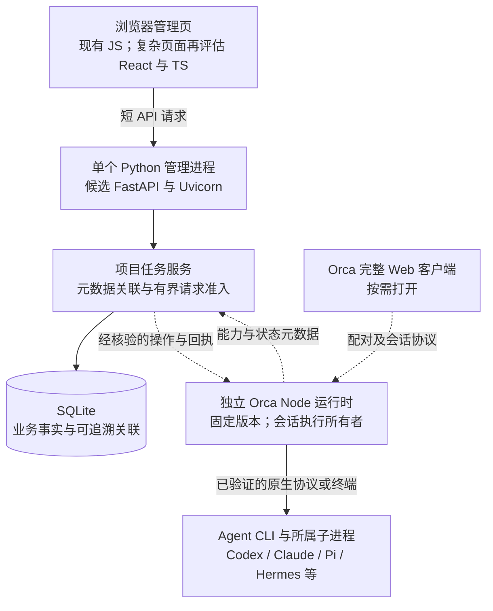

# 面板底层技术与多 Agent 稳定性建议

日期：2026-10-14；角色：hlplan；受众：中文使用者与后续实施者。
状态：待独立评审的技术补充；未实施、未压测，不替换旧高层方案或创建新的低层计划。
输入：[完整实现基线](clarifications.md)、[原高层方案](hlplan.md)、[原研究](research.md)、[稳定性研究](research_stability.md)、[Agent 兼容性研究](research_agent_compatibility.md)。

## 1. 推荐结论与范围

推荐保留 Python 业务模块，以成熟 ASGI 服务作为 HTTP 层候选，继续验证外置 Orca 和完整官方 Web 客户端。
当前没有证据表明 Python 是性能瓶颈，不建议为了预期并行量整体重写 Rust；先补资源准入、故障恢复、数据维护和可观测性。
并行 Agent 的主要成本可能来自模型等待、CLI、浏览器、MCP 与构建工具，须分项测量，不能由面板语言直接推算容量。
本建议回答 G1 的技术取舍与 G2 的验证方向；像素场景按 G3 延期。本轮仅规划，不安装、启动或恢复真实模型任务。

## 2. 当前事实与目标架构

当前是 Python 3.12、`ThreadingHTTPServer`、SQLite、原生 JavaScript 页面和 Edge 应用窗口；Orca 未接入。
自研 M3 已有幂等、目录互斥、最多 2 个繁忙运行及有界事件，但这不是 2 路稳定容量证明；真实模型验收仍暂停。
当前 HTTP 请求线程没有配置总量上限，Job 只用于所属进程生命周期，未设置 CPU／内存限额；数据库迁移、备份与运行托管仍缺明确方案。
以下是候选目标图，虚线接口仍需固定版本验证；不是当前部署图。

API 接受请求后返回操作标识；长任务由运行时继续执行，状态通过有界查询或订阅取得，不能占住一次 HTTP 请求直到模型结束。
图中业务模块在同一管理进程内，不新增微服务；Orca 独立进程提供故障边界，但系统内存或磁盘耗尽仍可能影响全部进程。
参考 [VS Code Extension Host](https://code.visualstudio.com/api/advanced-topics/extension-host) 的宿主隔离和惰性加载原则；其可靠性不能直接移植为本项目的保证。

## 3. 四项技术决策

### D1：保留业务资产，按已测瓶颈选择语言（G1）

| 选择 | 收益与成本 | 推荐与触发条件 |
|---|---|---|
| Python 业务＋成熟 ASGI＋外置 Orca | 复用现有管理逻辑；改善接口校验、服务生命周期；承担跨进程版本合同 | 当前推荐候选；先界定 HTTP 层迁移与回归范围 |
| 全部改成 TypeScript | 可共享前后端类型，接近 Orca 生态；仍要迁移现有数据和业务，承担重写验证 | 只有深度 Node 集成成为主要自有工作、且实测维护收益成立时重新比较 |
| 整体改成 Rust | 可减少部分运行时开销并增强编译期并发检查；迁移、绑定、发布成本更高 | 当前不采用；没有测量支持整体重写 |
| 局部 Rust 或 Rust 桌面壳 | 可处理已定位的 CPU 热点／特定系统能力；增加构建与接口维护 | 热点经 profiling 证实且优化现有方案不足时评估；桌面壳另由产品需求决定 |

[FastAPI](https://fastapi.tiangolo.com/async/) 是候选 HTTP 框架，不会自动把 sqlite3、文件或进程阻塞调用变成异步。
阻塞工作必须使用受限线程池或明确的后台工作位置；CPU 重任务用进程隔离等方案评估，不能直接塞进事件循环。
初期保留单个管理进程；直接设置多个 Uvicorn worker 会复制初始化、内存锁和执行 owner，不能当作无成本扩容。
只有派发所有者唯一、准入事实共享且恢复语义明确后，才评估多个 API worker。
[Rust](https://doc.rust-lang.org/book/ch16-03-shared-state.html) 可预防一部分并发错误，但仍会有死锁、重试重复执行与跨进程取消问题。
前端先复用 Orca 已有会话页面，自有复杂页面再增量评估 React／TypeScript；减少同时活跃的完整页面通常比换后端语言更直接。
继续浏览器优先；[Tauri 进程模型](https://tauri.app/concept/process-model/) 可作为未来安装包方案参考，不为使用 Rust 而引入桌面壳。

### D2：明确唯一事实与派发所有者（G1、G2）

- A：任务和人工验收归管理面，会话事实归 Orca，每个执行操作只有一个所有者（推荐）。
- B：面板镜像一套完整会话状态机并自行纠正 Orca。恢复冲突、升级与正文持久化成本高，近期不采用。
- C：只打开完整客户端。无法核验稳定标识与权限时可退到此范围，明确没有统一派发保证。

面板保存任务 ID 与 runtime／session／operation／receipt 的来源关联，不凭标题、终端最后一行或进程退出判断任务完成。
面板的请求准入只保护经过面板的路径；独立 Orca 页面、CLI 或其他宿主可以成为第二入口，现有局部锁不能约束它们。
若要求全局并发或同目录互斥，必须在共享运行时证明其原生控制有效，或明确所有受控派发进入唯一入口；做不到则标注覆盖范围。
面板拒绝超额请求即可起步，不默认增加通用任务队列；如后续需要排队，优先核查 runtime 原生能力与请求收据，不复制会话状态机。
提交超时不等于未执行：按原操作标识查询／对账，无法判定保持 unknown，禁止盲目重新 launch；旧 M3 与 Orca 不双派发同一任务。
客户端断连、取消某任务、停止运行时是三个独立动作。目标是刷新／关页面不自动停任务；显式停 runtime 的影响必须另有合同。
当前自研 M3 关闭服务时清理己方执行，不能将上述目标写成现状或擅自改变其恢复规则。

### D3：先限制资源，再增加并发与嵌入（G1、G2）

- A：按全局、Provider、工作目录设置有界准入，超额明确拒绝（推荐先做）；用实际资源曲线决定上限。
- B：无限线程／无限队列／默认同时挂载所有 WebView。瞬时可接收更多请求，但把过载拖成全局失稳，不采用。
- C：预设 Redis／Kafka 与微服务。当前单机没有需求或测量支持，延期。

| 容易遗漏的边界 | 后续设计必须能验证的行为 |
|---|---|
| Agent 数不是进程总数 | 计入 MCP、浏览器、构建及子代理；观察 CPU、内存、进程数、磁盘与 Provider 频率／额度 |
| 输出洪峰 | token／终端片段可批量合并并限量；单事件字节数、队列长度、总日志与磁盘保留量都需有界 |
| 审批和取消 | 控制请求与审批、错误、终止回执不能被 token 洪峰静默挤掉；单独预算、持久化确认与恢复规则 |
| 背压与耗尽 | 慢消费者减少订阅／丢弃可重建展示增量；关键事件无法可靠保存时明确失败或未知并拒绝新增操作 |
| 多个页面 | 非活跃页减订阅／暂停刷新，长列表按需渲染；卸载 WebView 不隐含取消后台 Agent |
| 同一项目并行修改 | 独立工作目录或 worktree 减少文件冲突；共享分支、构建目录与外部资源仍要核查 |
| 执行权限 | 工作目录、worktree、Job 和 Orca profile 都不是权限沙箱；凭证、home、MCP 自动发现及网络权限须单独限定 |
| 故障恢复 | 区分请求未接受、运行中断、未知与已终止；重启不自动重发，保留能追溯的原因与回执 |

限额应在真正拥有进程或协议的组件实施；面板看见指标不等于能够强制约束外置 Orca，能力不足时只承诺检测和拒绝新任务。
先维持 SQLite 与短事务，不把高频 token 全量逐条同步写入管理库；正文和会话持久化由原执行所有者负责。
[SQLite](https://www.sqlite.org/whentouse.html) 适合本机业务存储；持续写锁争用经测量无法接受、或多主机服务需求明确后再评估 PostgreSQL。
补版本化 schema migration、升级前一致性备份、还原演练和失败回退；不能假定新 schema 可直接给旧程序读取，也不直接复制活跃数据库当备份。
健康状态需分别描述 API 可响应、DB 可用、runtime 可连与 Provider 能力；指标保留聚合延迟和资源数据，避免凭证／正文进入日志。
运行托管必须限制重启风暴并保留失败原因；恢复管理服务不等于恢复或重发 Agent 任务。

### D4：按能力接入流行 Agent，固定兼容版本（G1、G2）

- A：优先复用 Orca 的现成终端和已验证协议，能力逐项显示 observed／unsupported／unknown（推荐）。
- B：所有菜单项都宣称支持统一聊天、审批、恢复、取消和费用。协议存在不代表适配成立，不采用。
- C：每个 Agent 再做一套面板专用适配。只有 Orca 的确缺失关键能力且收益明确时另评估，避免双份维护。

Pi 按 Pi coding agent 理解，原 badlogic/pi-mono 当前重定向到 earendil-works/pi；Hermes 指 NousResearch/hermes-agent。
固定 Orca 快照已观察到 `pi` 和 `hermes --tui` 的终端启动配置，所以有复用入口；尚不能确认其完整结构化接入。
Pi 自身有 RPC／TypeScript SDK；Hermes 自身有 ACP。固定 Orca 的 ACP spec 表只列 Grok、OpenCode、OMP；OMP 不能等同 Pi。
ACP 用于宿主与 Agent 会话交互，MCP 用于提供工具与资源；安装 MCP 不等于 Agent 已完整接入。
研究未追完所有 structured registry 构造调用方，AC1 未关闭，因此既不宣称 Pi／Hermes 已有完整适配，也不绝对断言没有专用 adapter。
不同协议的“已接受”“回合结束”“稳定结束”“取消完成”含义不同；Pi 最新文档的 `agent_settled` 与 `agent_end` 差别说明需要版本化合同。
每个 Agent 至少分别核验启动、流式事件、审批、取消、恢复、工作目录、凭证边界与费用字段；不支持的能力保留明确缺口。
固定 Orca、Node／原生依赖与 Agent 版本组合，记录兼容矩阵、许可证与自有适配代码量；升级先走无模型契约测试，再进入授权范围的真实验收。
Hermes 当前官方文档支持原生 Windows，但其 MCP、memory、skills 与 state 使用自身配置；Windows 文档与 Orca profile 均不能证明本机隔离已成立。

## 4. 最简验证顺序与未决风险

本轮没有性能测试。S-U1–S-U6、AC1–AC5 与原 U1–U6 仍是证据缺口；未知不能靠选择某种语言消除。

1. 先独立评审本建议，补 P1 的 Readiness 与低层设计；锁定版本、账户隔离、loopback、关闭责任和允许读取范围。
2. 在对应 Gate 后，先用无模型 fixture 做 2／4／8 路阶梯压力与恢复测试；这是候选测试负载，不是承诺当前支持 8 路。
3. 同时记录 API 延迟、控制操作延迟、DB 锁等待、事件丢失、CPU／内存／磁盘、孤儿进程及 UI 响应；基于固定机器和业务目标再定验收阈值。
4. 覆盖输出洪峰、Provider 卡死、断连、重启、磁盘满、写锁、取消和备份还原；临时数据验证，不碰用户数据库和凭证。
5. 启动前若 Provider home 或完整 App 自动读取边界不清，只补源码证据；默认 CLI serve 宽监听不能作为回退入口。
6. 无模型验证成立后才推进元数据关联；真实模型生命周期仍须另行明确额度与范围。只迁移已验收能力，Orca 不适合时保留仅入口或旧 M3。

下游需把准入覆盖范围、阻塞调用工作位置、控制事件保存、数据库升级回退和多入口协调写到可实现精度，再提出具体改动。
可靠性结论应来自上述测试与运行记录；技术选择本身不构成长期稳定保证。像素场景不进入这些验证的关键路径。

无新增跨功能事实；相关可复用事实已由两份补充研究记录。
